<div align="center">

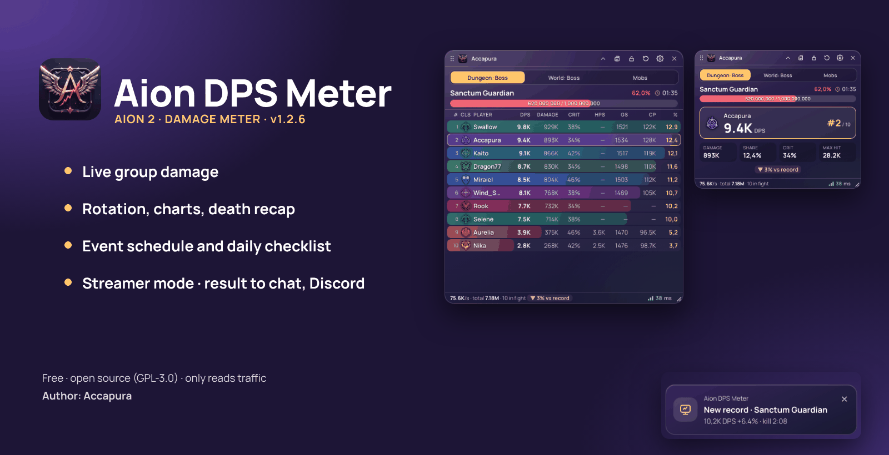

# Aion DPS Meter

**Damage meter, event schedule and fight statistics for AION 2**

[](https://github.com/Accapura/AionDpsMeter/releases/latest)
[](https://github.com/Accapura/AionDpsMeter/releases/latest)
[](LICENSE)

[Русский](README.md) · **English**

<sub>[Features](#-features) · [Screenshots](#-screenshots) · [Install](#-install) · [Hotkeys](#️-hotkeys) · [How it works](#️-how-it-works)</sub>

</div>

---

## ✨ Features

| | |
|---|---|
| ⚔️ **In-game overlay** | DPS, damage, share, crit and healing for every player. Boss HP, fight timer, phases and kill ETA, your place and the gap to your record. Dungeon: Boss, World: Boss and Mobs modes. Gear score and combat power columns, eDPS / aDPS, ping indicator and lag alert. |
| 🎯 **Solo view** | Your own DPS, place in the group, damage, share and crit in big numbers instead of the group list. |
| 🏆 **Records** | A “New record” toast right after the fight, personal bests per boss, comparison with your previous fight and with your class median. |
| 📈 **Statistics** | Fight history with search and export, DPS chart with boss phases, growth chart, two-fight comparison, DPS by class. |
| 🎼 **Rotation and hit quality** | A skill timeline over the fight and crit, back, perfect, heavy, multi and double hit rates for every skill. |
| ☠️ **Death recap** | Who hit you with what in the last 12 seconds before dying, death statistics. |
| 💬 **Share a fight** | Result card image, a line for the in-game chat (`Ctrl+Shift+T`) and one-click posting to a guild Discord channel; “Boss fight” status in your Discord profile. |
| 📅 **Schedule and checklist** | Events, rifts and world bosses in the selected server time, reminders, custom events, field boss timers from the game. A daily and weekly checklist that resets by itself. |
| 🎥 **Streamer mode** | Player nicknames become “Player NN” in the overlay and the app (`Ctrl+Shift+H`). |
| ⚡ **Light updates** | New versions (~1.5 MB) download and install in seconds. Start with Windows is optional. |
| 🔔 **Notifications** | Hide themselves after 8 seconds (3–30 in settings); every kind has its own switch and sound, 6 new soft sounds and 10 styles to choose from. |
| 🎨 **Look** | 11 themes, 10 notification styles, Russian and English. |

## 📸 Screenshots

<table>
<tr><td width="33%" align="center">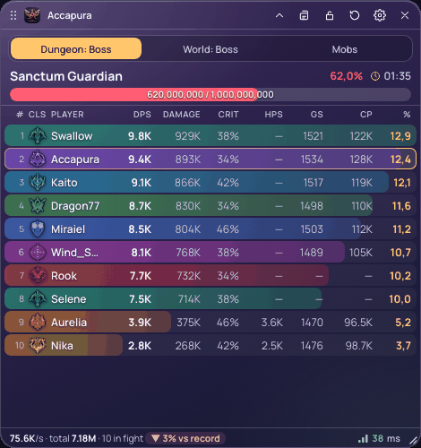<br><sub><b>Overlay</b> — group damage, GS and CP, ping</sub></td><td width="33%" align="center">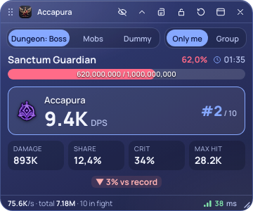<br><sub><b>Solo view</b> — your DPS and place</sub></td><td width="33%" align="center">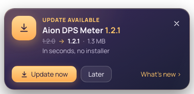<br><sub><b>Record</b> — toast after the fight</sub></td></tr>
<tr><td width="33%" align="center">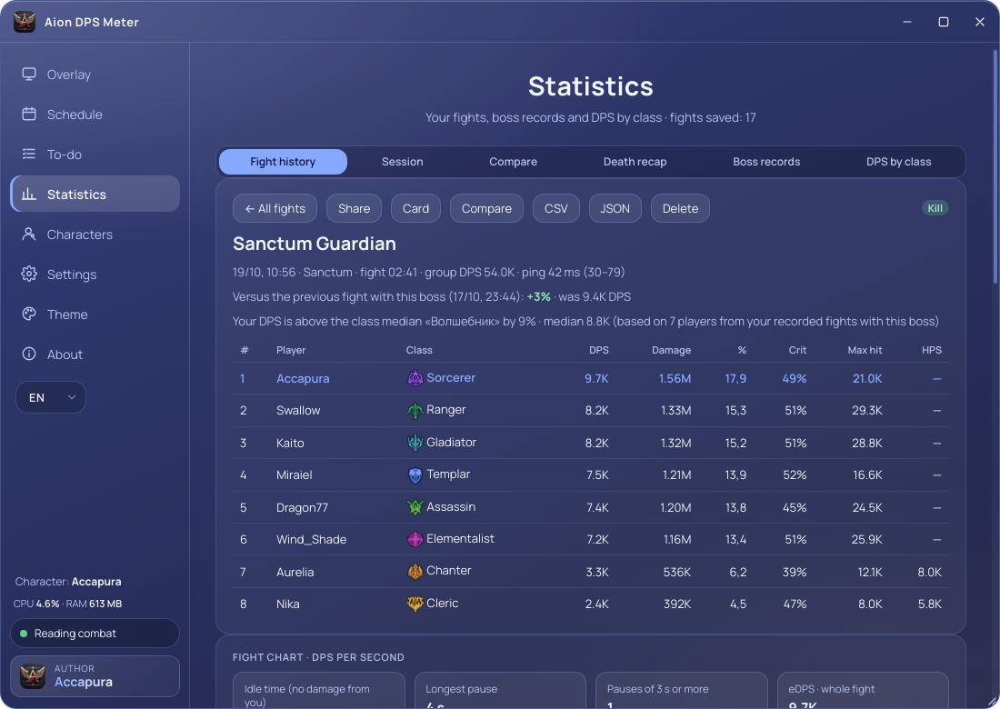<br><sub><b>Fight history</b> — class, previous fight, ping</sub></td><td width="33%" align="center">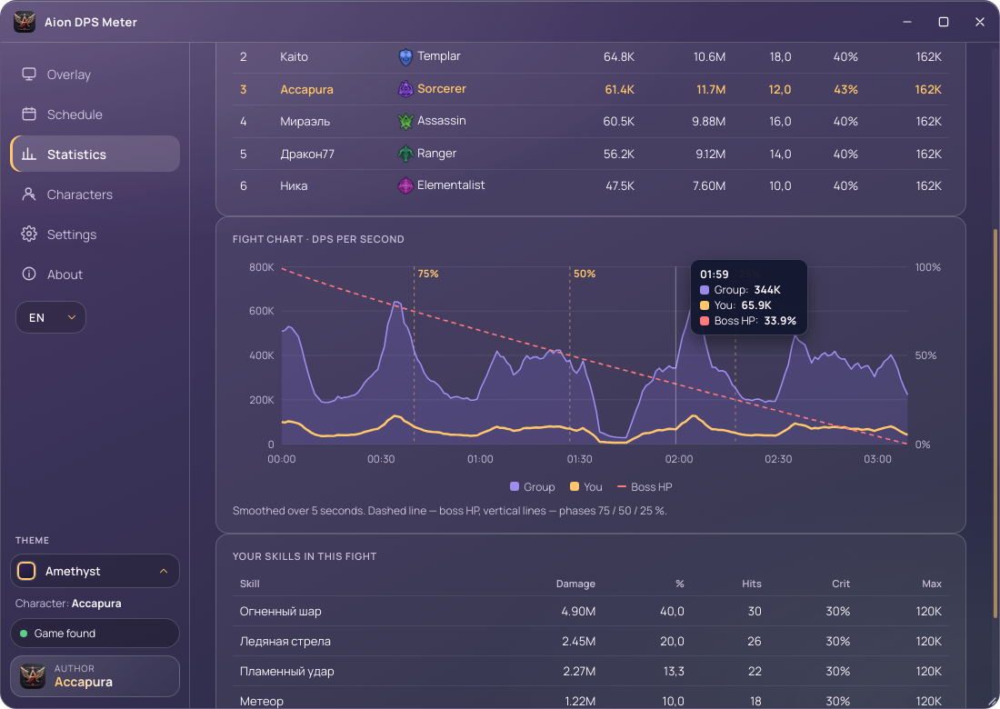<br><sub><b>Fight chart</b> — DPS per second and phases</sub></td><td width="33%" align="center">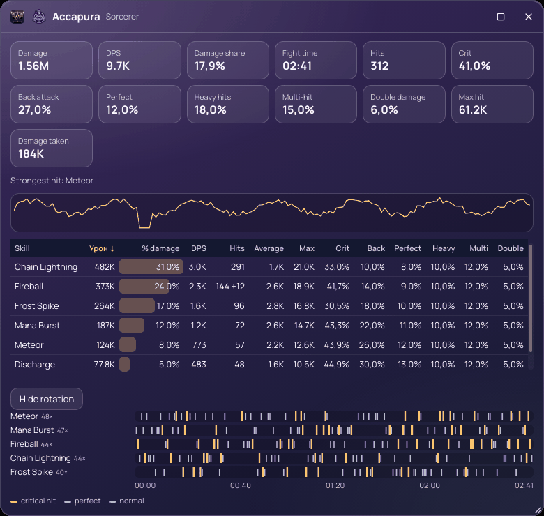<br><sub><b>Rotation</b> — skill timeline and hit quality</sub></td></tr>
<tr><td width="33%" align="center">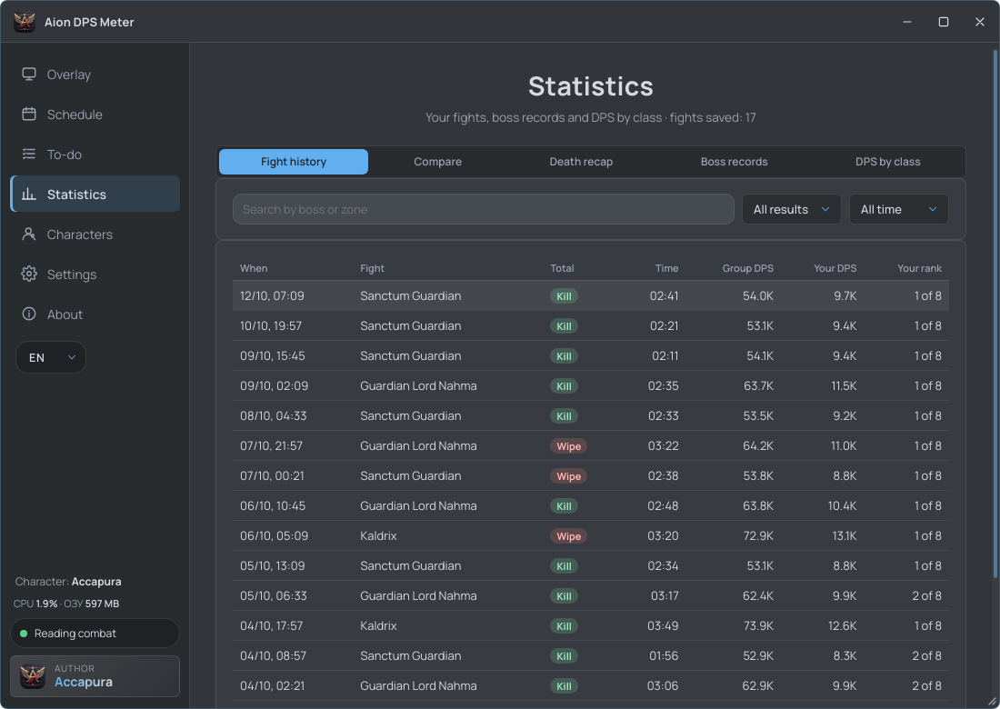<br><sub><b>History</b> — search, filters, export</sub></td><td width="33%" align="center">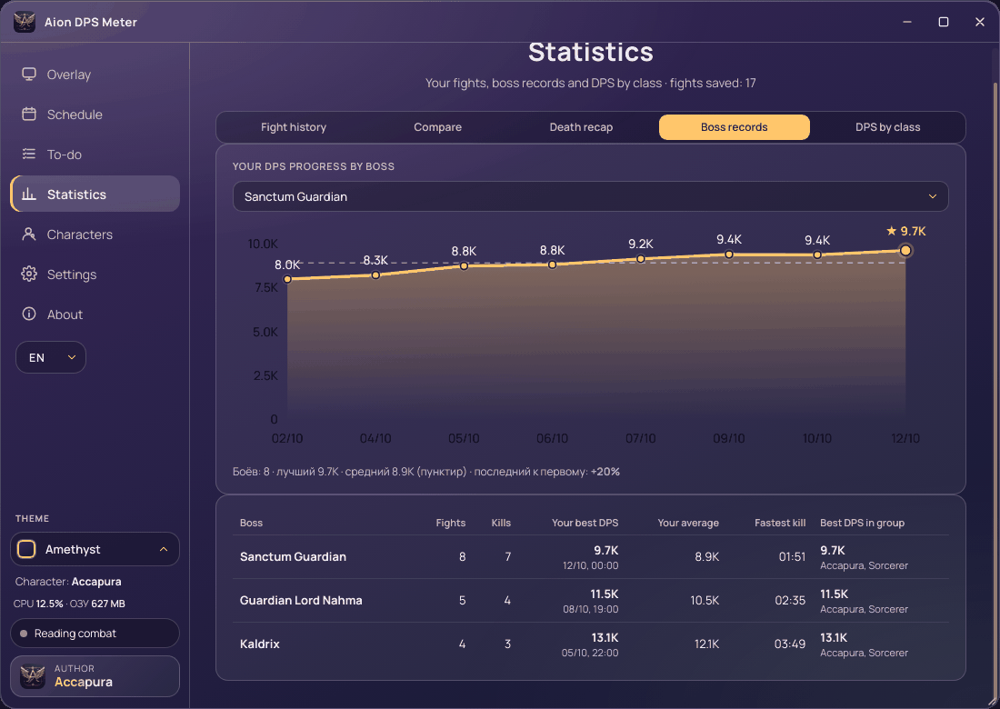<br><sub><b>Records</b> — DPS growth per boss</sub></td><td width="33%" align="center">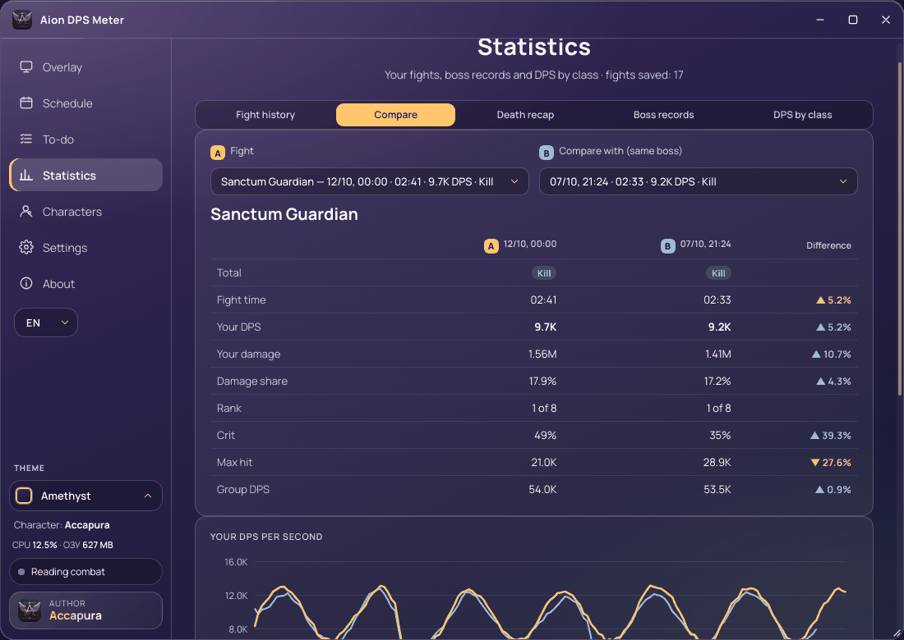<br><sub><b>Compare</b> — where damage was lost</sub></td></tr>
<tr><td width="33%" align="center">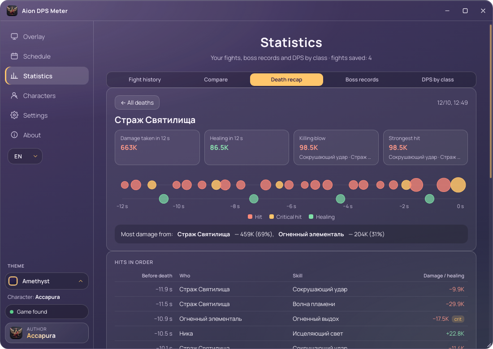<br><sub><b>Death recap</b> — the last 12 seconds</sub></td><td width="33%" align="center">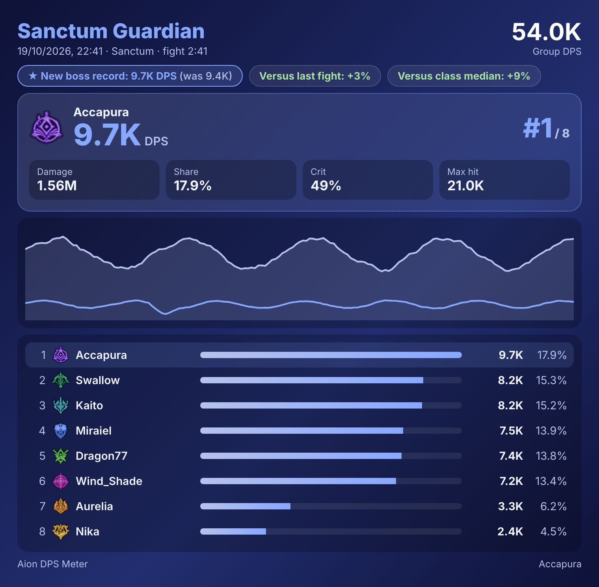<br><sub><b>Result card</b> — for Discord and chat</sub></td><td width="33%" align="center">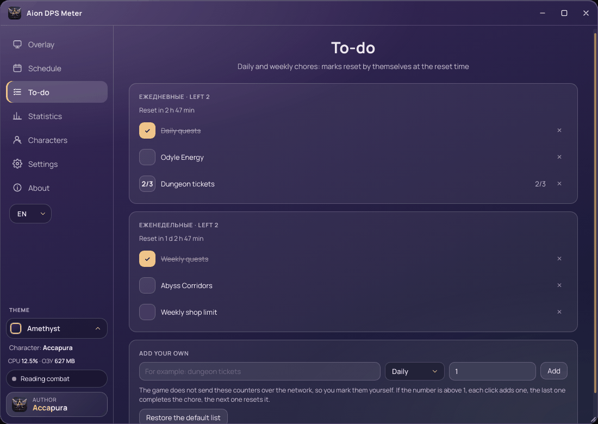<br><sub><b>Checklist</b> — daily and weekly</sub></td></tr>
<tr><td width="33%" align="center">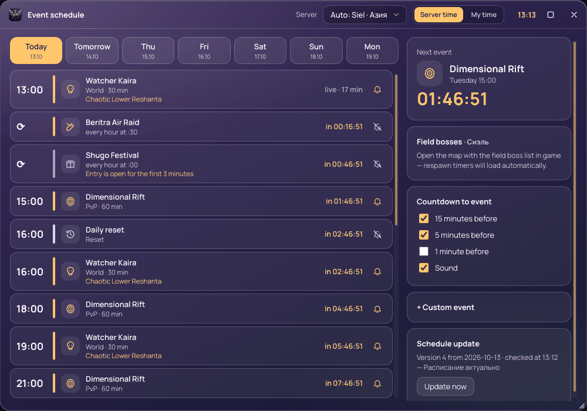<br><sub><b>Schedule</b> — events in server time</sub></td><td width="33%" align="center">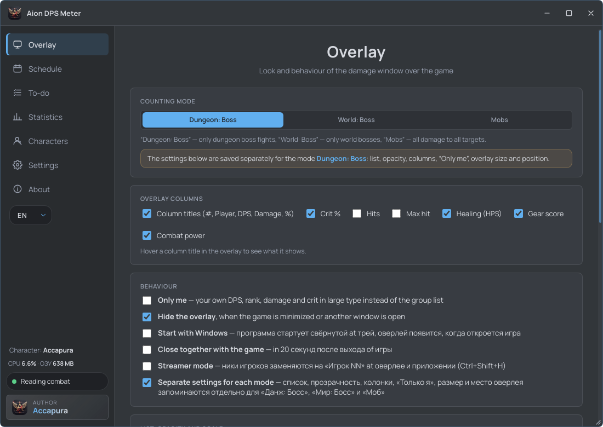<br><sub><b>Settings</b> — columns, behavior, streamer mode</sub></td><td width="33%" align="center">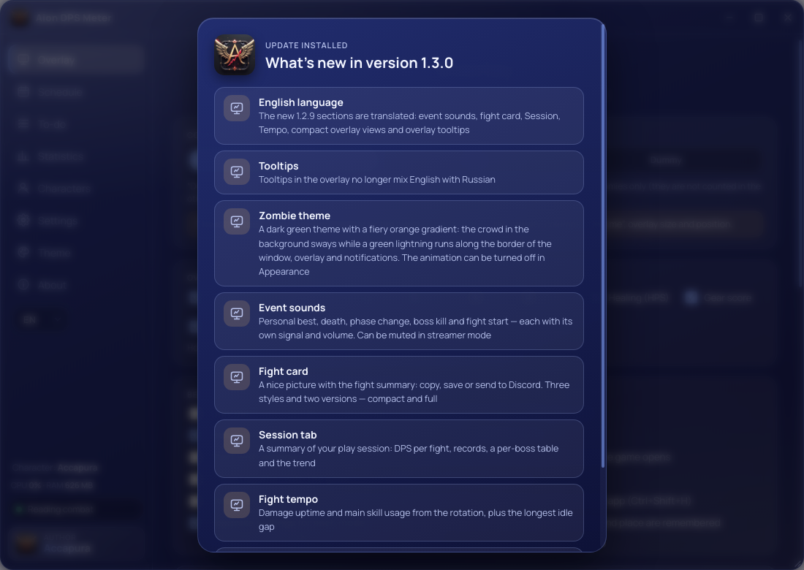<br><sub><b>What’s new</b> — after an update</sub></td></tr>
</table>

<p align="center"><br><sub><b>Installer</b> in the app’s style</sub></p>

## 📥 Install

1. Download the installer **`AionDpsMeter.vX.Y.Z.exe`** from [**Releases**](https://github.com/Accapura/AionDpsMeter/releases/latest) and run it.
2. Pick the language, accept the agreement and choose a folder — the app appears in the Start menu.
3. To read fights you need (the installer checks and gives links):
   - [**Npcap**](https://npcap.com/#download) — traffic capture driver, install with default options;
   - [**.NET 10 Runtime**](https://dotnet.microsoft.com/download/dotnet/10.0) — for the fight reader (Windows x64).
4. Start Aion DPS Meter **before entering a dungeon** — the game sends player names on the loading screen.

**Supported clients:** AION 2 Global · Steam, AION 2 Global · PURPLE. Windows 10 / 11 x64.

After that the app updates itself: when “Update available” appears, click **“Update now”**.

## ⌨️ Hotkeys

| Keys | Action |
|---|---|
| `Ctrl+Shift+D` | show / hide the overlay |
| `Ctrl+Shift+L` | lock the overlay (click-through) |
| `Ctrl+Shift+R` | reset the meter |
| `Ctrl+Shift+C` | share the fight summary (image and text, or to a Discord channel) |
| `Ctrl+Shift+1` / `2` / `3` | Dungeon: Boss / World: Boss / Mobs mode |
| `Ctrl+Shift+M` | next mode (cycle) |
| `Ctrl+Shift+T` | fight summary as a line for the in-game chat |
| `Ctrl+Shift+H` | streamer mode (hide nicknames) |

Every combination can be changed in Overlay → Hotkeys.

## 🛡️ How it works

Aion DPS Meter **only reads** the game’s network traffic on your computer (via Npcap): it sends nothing to the game and does not read or change its memory or files.

> [!IMPORTANT]
> The app is not affiliated with or endorsed by NCSoft. NCSoft has not publicly banned such damage meters, nor officially allowed them — you use the app at your own risk with regard to the NCSoft terms of service. If NCSoft bans them, fight reading will be disabled by an update. AION 2, class names and emblems are the property of NCSoft.

## 🔧 Building from source

```
app/      — the app (Electron 33): windows, overlay, schedule, statistics
bridge/   — fight reader (.NET 10): game packet parsing, JSON to stdout
setup/    — installer (NSIS) and light updates
```

```bash
cd bridge && dotnet publish -c Release -o ../bridge-out -p:UseAppHost=false
cd app && npm install && npm start
cd setup && python3 art.py <version> && python3 gen.py <version> <app_folder> && makensis setup.nsi
```

## 🙏 Credits and licenses

Aion DPS Meter is distributed under the **GNU GPL v3** — see [LICENSE](LICENSE).

- **AionMeter.Core** — [cyberbadger6969/aion2-dps-meter](https://github.com/cyberbadger6969/aion2-dps-meter) (GPL-3.0) — game protocol parsing.
- Game data tables — [taengu/A2Tools-DPS-Meter](https://github.com/taengu/A2Tools-DPS-Meter) (GPL-3.0); healing skill ids and class emblems — [Kuroukihime/AIon2-Dps-Meter](https://github.com/Kuroukihime/AIon2-Dps-Meter) (GPL-3.0). AION 2 game data © NCSOFT.
- SharpPcap, PacketDotNet (MIT), Electron (MIT), Chromium, Manrope font (SIL OFL 1.1).

## 💬 Author

<table><tr>
<td></td>
<td><b>Accapura</b><br>Development, ideas and support<br>Discord: <b>Accapura</b> · <a href="https://discord.com/users/256419758369538048">message</a></td>
</tr></table>

Found a bug? In the app: **Settings → Error report** — send the file to the author on Discord or open an [Issue](https://github.com/Accapura/AionDpsMeter/issues).
