<div align="center">

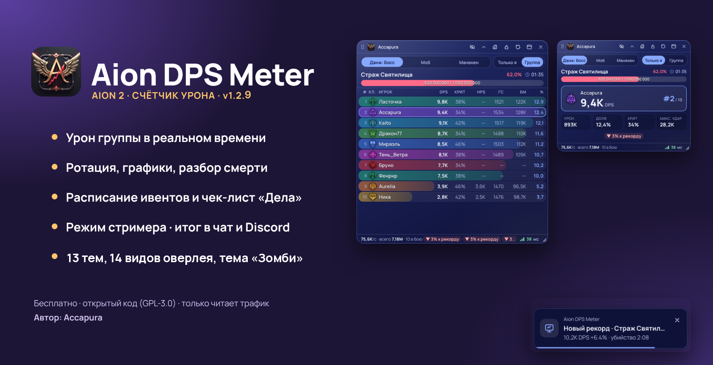

# Aion DPS Meter

**Счётчик урона, расписание ивентов и статистика боёв для AION 2**

[](https://github.com/Accapura/AionDpsMeter/releases/latest)
[](https://github.com/Accapura/AionDpsMeter/releases/latest)
[](LICENSE)

**Русский** · [English](README.en.md)

<sub>[Возможности](#-возможности) · [Скриншоты](#-скриншоты) · [Установка](#-установка) · [Горячие клавиши](#️-горячие-клавиши) · [Как это работает](#️-как-это-работает)</sub>

</div>

---

## ✨ Возможности

| | |
|---|---|
| ⚔️ **Оверлей поверх игры** | DPS, урон, доля, крит и лечение каждого игрока. HP босса, таймер боя, фазы и прогноз убийства, место и отрыв от вашего рекорда. Режимы «Данж: Босс» (только подземелья), «Моб» и «Манекен» (тест DPS на тренировочном манекене). Колонки гир-скора и боевой мощи, eDPS / aDPS, индикатор пинга и предупреждение о лаге. |
| ⏳ **Таймер берсерка** | Обратный отсчёт до берсерка (5:00 боя) рядом с HP босса — для боссов с подтверждённым временем. |
| 🎯 **«Только я»** | Крупно свой DPS, место в группе, урон, доля и крит — вместо списка группы. |
| 🏆 **Рекорды** | Тост «Рекорд побит» сразу после боя, личные рекорды по каждому боссу, сравнение с прошлым боем и с медианой вашего класса. |
| 📈 **Статистика** | История боёв с поиском и экспортом, график DPS с фазами босса, график роста, сравнение двух боёв, DPS по классам. |
| 🎼 **Ротация и качество ударов** | Лента применения навыков по времени боя и доли крита, удара в спину, идеальных, тяжёлых, мульти- и двойных ударов по каждому навыку. |
| ☠️ **Разбор смерти** | Кто и чем ударил за последние 12 секунд перед смертью, статистика смертей. |
| 💬 **Поделиться боем** | Картинка-итог, строка в игровой чат (`Ctrl+Shift+T`) и отправка в Discord-канал гильдии одной кнопкой; статус «Бой с боссом» в профиле Discord. |
| 📅 **Расписание и «Дела»** | Ивенты, разломы и мировые боссы по времени сервера, напоминания, свои ивенты, таймеры полевых боссов из игры. Чек-лист ежедневных и недельных дел, который сбрасывается сам. |
| 🎥 **Режим стримера** | Ники игроков заменяются на «Игрок NN» в оверлее и приложении (`Ctrl+Shift+H`). |
| ⚡ **Лёгкие обновления** | Новые версии (~1,5 МБ) скачиваются и ставятся сами за пару секунд. Запуск вместе с Windows — по желанию. |
| 🔔 **Уведомления** | Исчезают сами через 8 секунд (3–30 в настройках); у каждого вида — свой переключатель и звук, 6 новых мягких звуков и 10 оформлений на выбор. |
| 🎨 **Оформление** | 13 цветных тем, форма углов (закруглённые или квадратные), положение меню и кнопок оверлея, 14 видов списка урона (три компактных — только ваш DPS) и кнопка «Только урон» (`Ctrl+Shift+U`). Темы «Чёрное пламя» и «Зомби» с живыми эффектами, которые можно выключить. 10 стилей уведомлений, русский и английский язык. Карточка итога рисуется в цветах темы. |
| 🔊 **Звуки событий** | Личный рекорд, смерть, смена фазы, убийство босса и начало боя — каждому свой звук и громкость; отключаются в режиме стримера. |
| 🖼️ **Карточка боя** | Картинка с итогом боя: копировать, сохранить или отправить в Discord. Три стиля, компактный и полный вид. |
| 📊 **Сессия и темп боя** | Вкладка «Сессия» — итоги игрового вечера по боям и боссам; «Темп боя» — аптайм урона и использование главных умений. |
| 💜 **Поддержка автора** | Программа бесплатная. На странице «О программе» есть QR для добровольного доната по СБП — он ничего не открывает и не блокирует. |

## 📸 Скриншоты

<p align="center">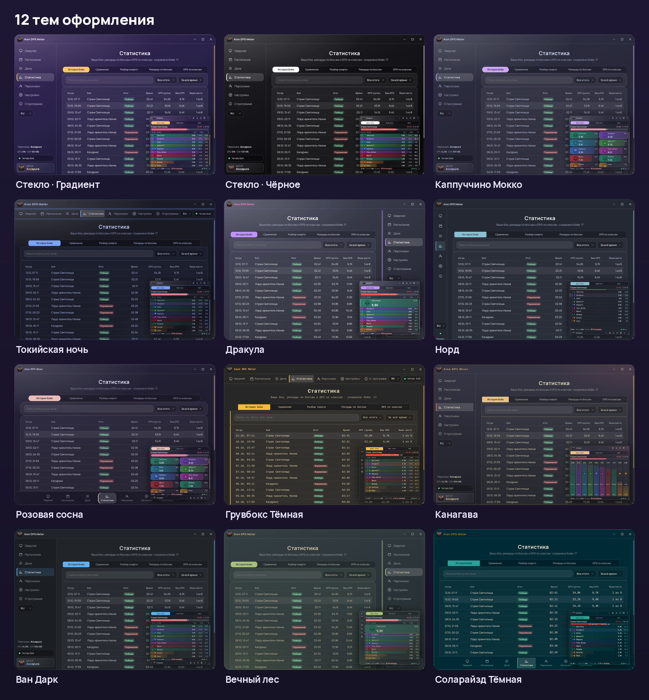<br><sub><b>12 тем и 11 видов оверлея: цвета, форма углов и раскладка интерфейса</b></sub></p>

<table>
<tr><td width="33%" align="center">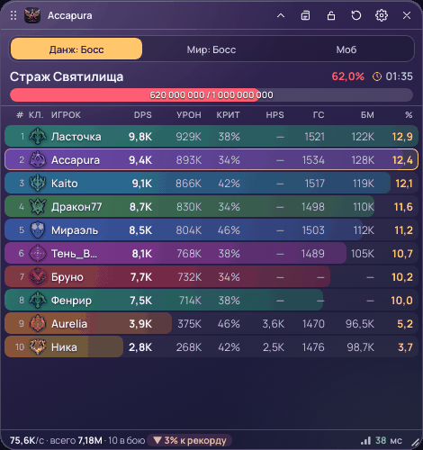<br><sub><b>Оверлей</b> — урон группы, ГС и БМ, пинг</sub></td><td width="33%" align="center">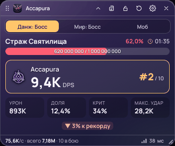<br><sub><b>«Только я»</b> — свой DPS и место</sub></td><td width="33%" align="center">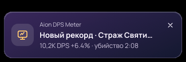<br><sub><b>Рекорд</b> — тост после боя</sub></td></tr>
<tr><td width="33%" align="center">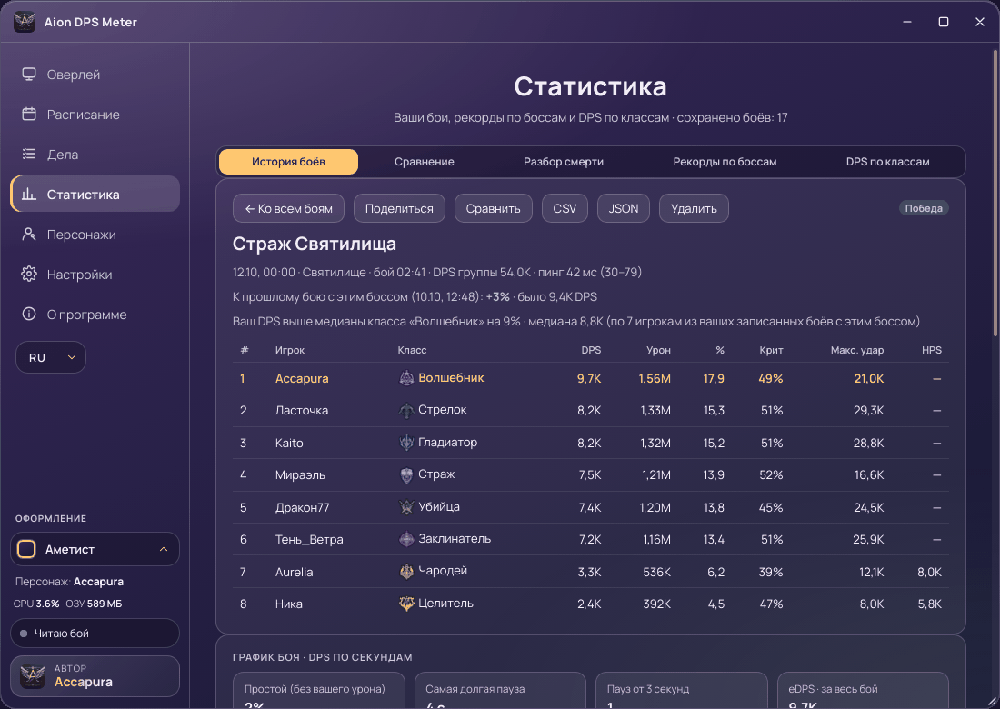<br><sub><b>История боя</b> — класс, прошлый бой, пинг</sub></td><td width="33%" align="center">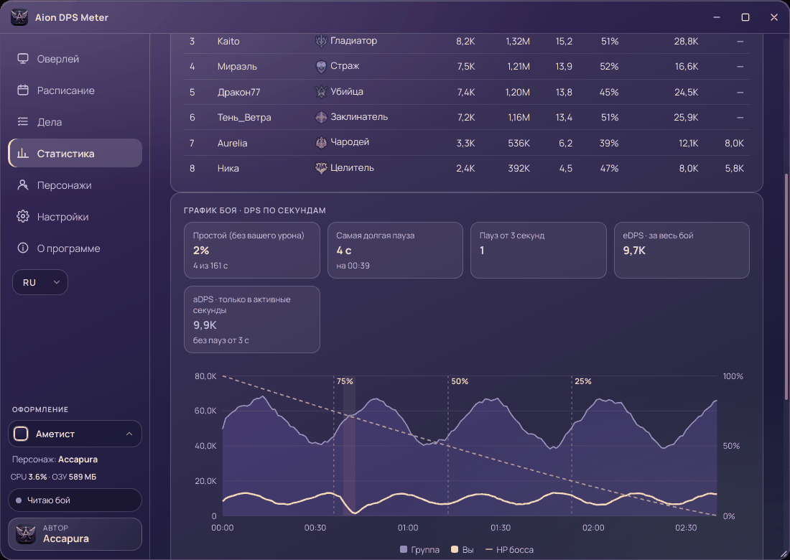<br><sub><b>График боя</b> — DPS по секундам и фазы</sub></td><td width="33%" align="center">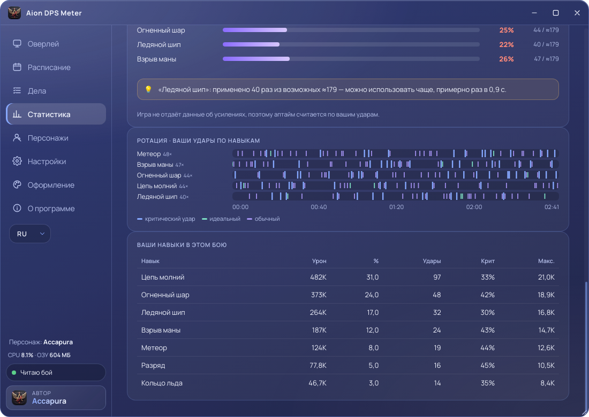<br><sub><b>Ротация</b> — лента навыков и качество ударов</sub></td></tr>
<tr><td width="33%" align="center">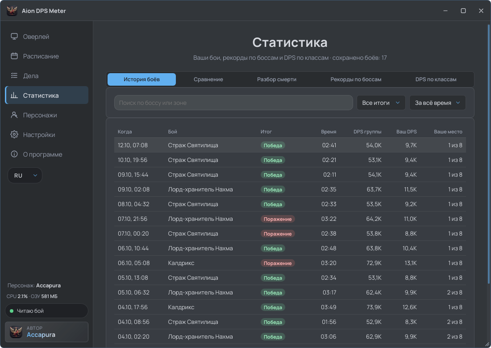<br><sub><b>История</b> — поиск, фильтры, экспорт</sub></td><td width="33%" align="center">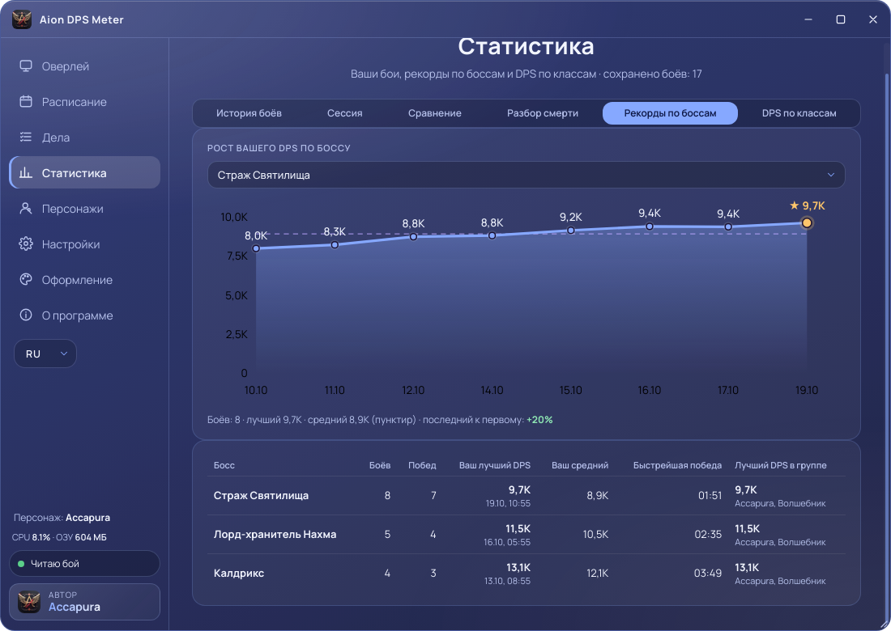<br><sub><b>Рекорды</b> — рост DPS по боссам</sub></td><td width="33%" align="center">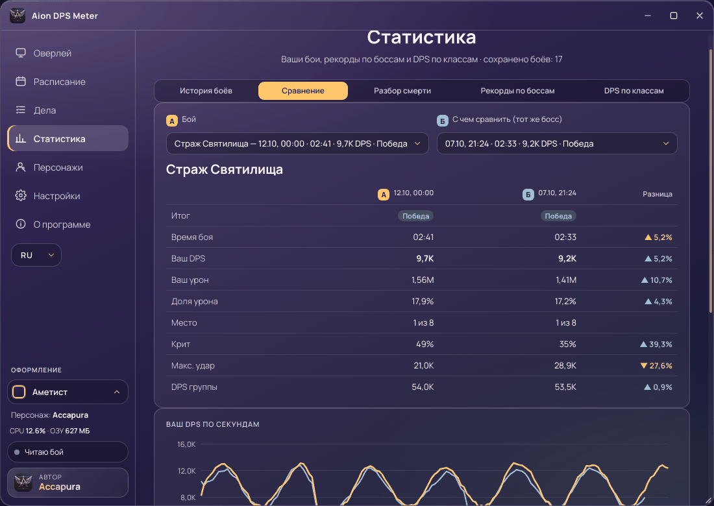<br><sub><b>Сравнение</b> — где потерян урон</sub></td></tr>
<tr><td width="33%" align="center">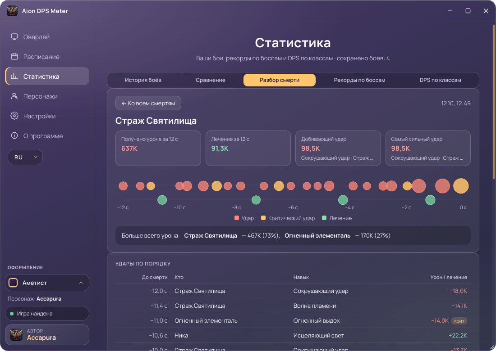<br><sub><b>Разбор смерти</b> — последние 12 секунд</sub></td><td width="33%" align="center">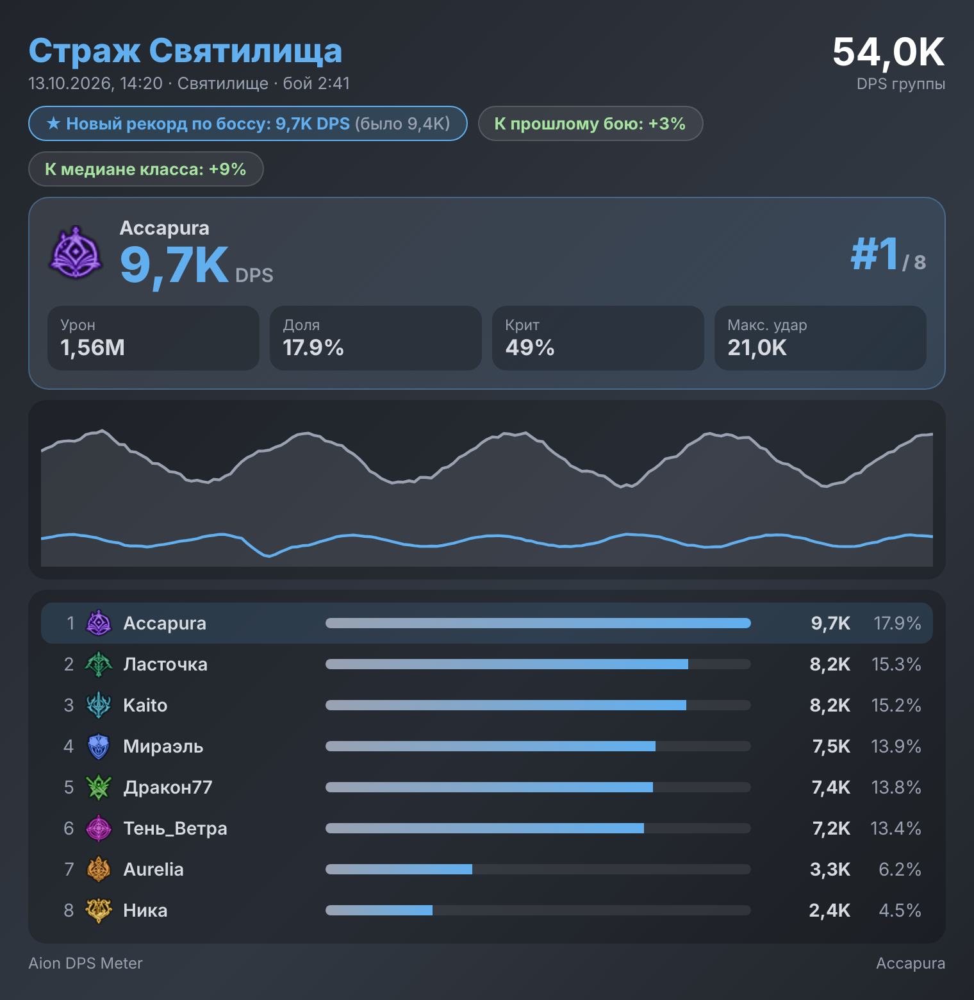<br><sub><b>Карточка итога</b> — для Discord и чата</sub></td><td width="33%" align="center">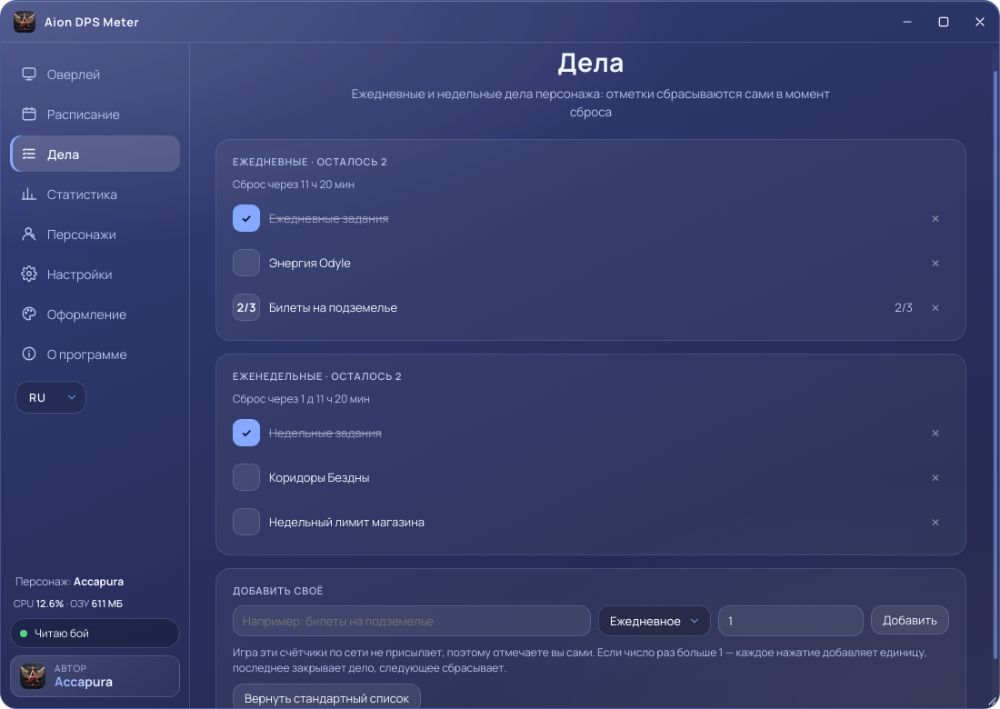<br><sub><b>Дела</b> — ежедневные и недельные</sub></td></tr>
<tr><td width="33%" align="center">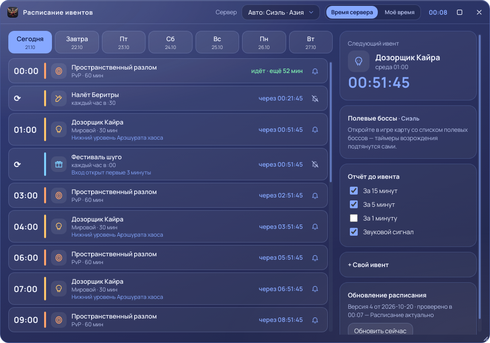<br><sub><b>Расписание</b> — ивенты по времени сервера</sub></td><td width="33%" align="center">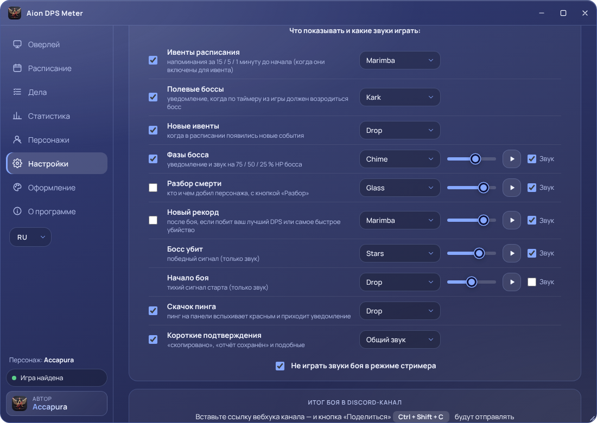<br><sub><b>Настройки</b> — колонки, поведение, режим стримера</sub></td><td width="33%" align="center">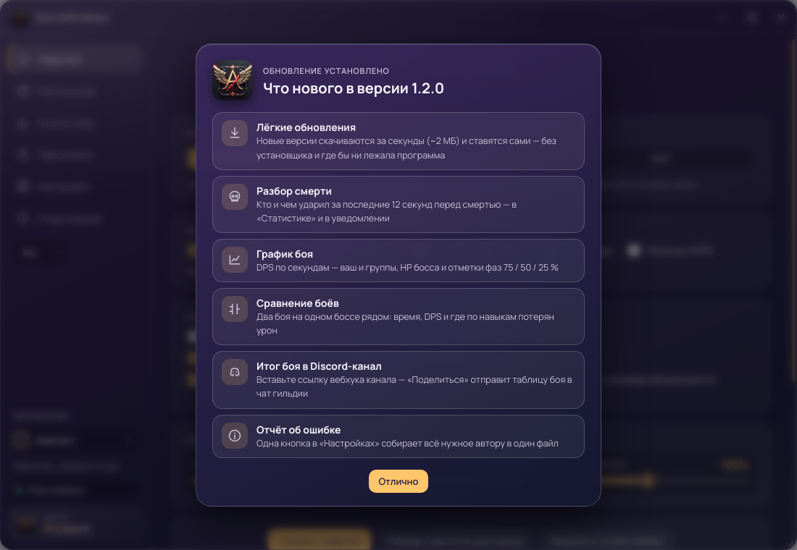<br><sub><b>Что нового</b> — после обновления</sub></td></tr>
</table>

<p align="center">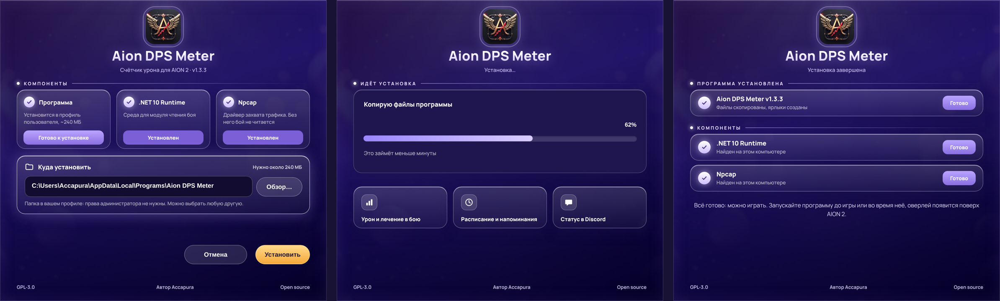<br><sub><b>Установщик</b> в стиле программы</sub></p>

## 📥 Установка

<p align="center">
<a href="https://github.com/Accapura/AionDpsMeter/releases/latest"></a>
</p>

<table>
<tr>
<td width="64" align="center"><h2>1</h2></td>
<td><b>Скачайте и запустите установщик</b><br>Файл <code>AionDpsMeter.vX.Y.Z.exe</code> — на странице <a href="https://github.com/Accapura/AionDpsMeter/releases/latest">Releases</a>. Выберите язык, примите соглашение и папку: программа появится в меню «Пуск».</td>
</tr>
<tr>
<td align="center"><h2>2</h2></td>
<td><b>Поставьте два компонента для чтения боя</b><br>Установщик сам их проверит и даст ссылки. Npcap — с настройками по умолчанию.<br><br>
<a href="https://npcap.com/#download"></a>
<a href="https://dotnet.microsoft.com/download/dotnet/10.0"></a></td>
</tr>
<tr>
<td align="center"><h2>3</h2></td>
<td><b>Запускайте до входа в подземелье</b><br>Имена игроков игра присылает на экране загрузки — если программа уже запущена, ники будут в оверлее с первой секунды.</td>
</tr>
<tr>
<td align="center"><h2>4</h2></td>
<td><b>Дальше всё само</b><br>Когда выйдет новая версия, появится уведомление «Доступно обновление» — нажмите <b>«Обновить сейчас»</b>. Настройки и история боёв сохраняются.</td>
</tr>
</table>

> [!NOTE]
> **Поддерживаемые клиенты:** AION 2 Global · Steam и AION 2 Global · PURPLE. **Система:** Windows 10 / 11 x64.

## ⌨️ Горячие клавиши

| Сочетание | Действие |
|---|---|
| `Ctrl+Shift+D` | показать / скрыть оверлей |
| `Ctrl+Shift+L` | закрепить оверлей (клики проходят сквозь) |
| `Ctrl+Shift+R` | начать подсчёт заново |
| `Ctrl+Shift+C` | поделиться итогом боя (картинка и текст, или в Discord-канал) |
| `Ctrl+Shift+1` / `3` / `4` | режим «Данж: Босс» / «Моб» / «Манекен» |
| `Ctrl+Shift+M` | следующий режим по кругу |
| `Ctrl+Shift+T` | итог боя строкой в игровой чат |
| `Ctrl+Shift+H` | режим стримера (скрыть ники) |

Любое сочетание меняется в «Оверлей → Горячие клавиши».

## 🛡️ Как это работает

Aion DPS Meter **только читает** сетевой трафик игры на вашем компьютере (через Npcap): ничего не отправляет в игру, не читает и не изменяет её память и файлы.

> [!IMPORTANT]
> Программа не связана с NCSoft и не одобрена ею. NCSoft публично не запрещала такие счётчики урона, но и официального разрешения не давала — вы используете программу на свой страх и риск в отношении условий обслуживания NCSoft. Если NCSoft объявит запрет, чтение боя будет отключено обновлением. AION 2, названия и эмблемы классов — собственность NCSoft.

## 🔧 Сборка из исходников

```
app/      — программа (Electron 33): окна, оверлей, расписание, статистика
bridge/   — модуль чтения боя (.NET 10): разбор пакетов игры, JSON в stdout
setup/    — установщик (NSIS) и лёгкие обновления
```

```bash
# модуль чтения
cd bridge && dotnet publish -c Release -o ../bridge-out -p:UseAppHost=false
# программа (для запуска из исходников)
cd app && npm install && npm start
# установщик: art.py рисует графику, gen.py собирает setup.nsi, затем makensis
cd setup && python3 art.py <версия> && python3 gen.py <версия> <папка_с_программой> && makensis setup.nsi
```

## 🙏 Благодарности и лицензии

Aion DPS Meter распространяется по лицензии **GNU GPL v3** — см. [LICENSE](LICENSE).

- **AionMeter.Core** — [cyberbadger6969/aion2-dps-meter](https://github.com/cyberbadger6969/aion2-dps-meter) (GPL-3.0) — разбор протокола игры.
- Таблицы данных игры — [taengu/A2Tools-DPS-Meter](https://github.com/taengu/A2Tools-DPS-Meter) (GPL-3.0); id лечащих навыков и эмблемы классов — [Kuroukihime/AIon2-Dps-Meter](https://github.com/Kuroukihime/AIon2-Dps-Meter) (GPL-3.0). Данные игры AION 2 © NCSOFT.
- SharpPcap, PacketDotNet (MIT), Electron (MIT), Chromium, шрифт Manrope (SIL OFL 1.1).

## 💬 Автор

<table><tr>
<td>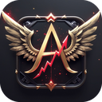</td>
<td><b>Accapura</b><br>Разработка, идеи и поддержка<br>Discord: <b>Accapura</b> · <a href="https://discord.com/users/256419758369538048">написать</a></td>
</tr></table>

Нашли ошибку? В программе: **«Настройки» → «Отчёт об ошибке»** — пришлите файл автору в Discord или откройте [Issue](https://github.com/Accapura/AionDpsMeter/issues).
